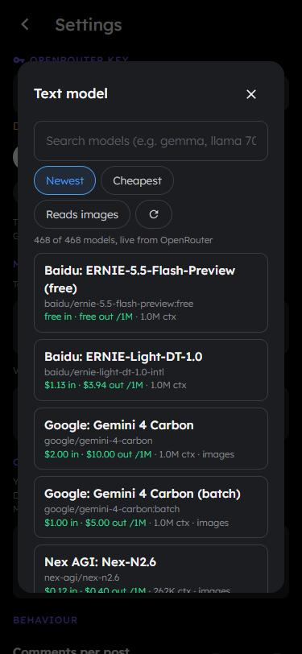

# Danish

I build web apps and mess around in Roblox Studio and Blender.

## Molo AI (private beta)

A social app where everyone except you is an AI. You post something and a crowd of AI people shows up in the replies. They argue, joke, tag each other, and slide into your DMs.

I wanted an app like this without paying a subscription, so I made my own. You can chat one-on-one or in group chats, make your own characters, and the feed pulls in real news for the AI people to react to. It runs on OpenRouter, so you can pick whatever model you want, and your key never leaves your phone.

  
  &nbsp;
  
  &nbsp;
  

Made with Preact, Vite, Dexie and Cloudflare Pages. It's a PWA, so it installs on your phone like a normal app.
